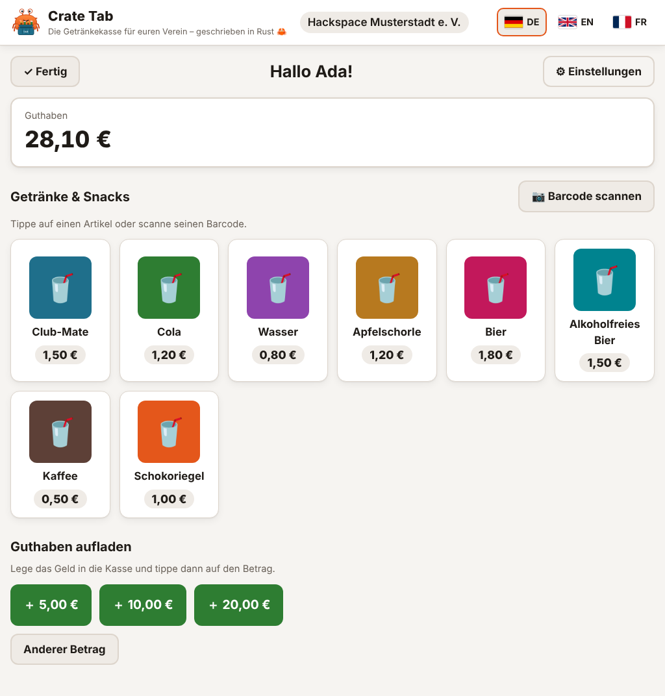
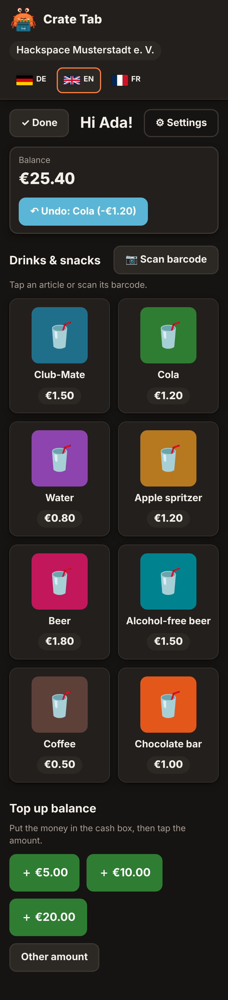

<p align="center">
  
</p>

<h1 align="center">Crate Tab</h1>

<p align="center"><strong>Die Getränkekasse für euren Verein – geschrieben in Rust 🦀</strong></p>

Mitglieder buchen Getränke selbst von ihrem Guthaben ab, entweder an einem Tablet
oder Raspberry Pi im Kiosk-Modus oder am eigenen Handy. Ein Admin-Bereich verwaltet Artikel,
Benutzer und Buchungen. Crate Tab ersetzt das alte *fnordcredit* (RethinkDB) und
besteht aus **einer einzigen Programmdatei** mit **einer SQLite-Datei** als Datenbank.

<p align="center">
  
  
</p>

## Inhalt

- [Funktionen](#funktionen)
- [Schnellstart](#schnellstart)
- [Konfiguration](#konfiguration)
- [Installation auf Proxmox](#installation-auf-proxmox)
- [Reverse Proxy mit HTTPS](#reverse-proxy-mit-https)
- [Kiosk auf dem Raspberry Pi](#kiosk-auf-dem-raspberry-pi)
- [Backup und Wiederherstellung](#backup-und-wiederherstellung)
- [Update](#update)
- [Neue Sprache hinzufügen](#neue-sprache-hinzufügen)
- [Hilfsbefehle](#hilfsbefehle)
- [Entwicklung](#entwicklung)

## Funktionen

**Kiosk (touch-optimiert)**
- Startseite mit Kacheln aller Mitglieder, Suche und Buchstabenleiste
- Optionale PIN pro Mitglied (4–8 Ziffern), mit Ziffernblock auf dem Bildschirm.
  Nach 5 Fehlversuchen ist die PIN 5 Minuten gesperrt
- Artikel als Kacheln mit Bild und Preis, oder per Barcode:
  - **USB-Scanner**: einfach scannen, es muss kein Feld ausgewählt sein
  - **Kamera**: im Browser über den eingebauten `BarcodeDetector` oder, falls nicht vorhanden,
    über das mitgelieferte zxing (EAN-13, EAN-8, UPC, Code 128)
- Guthaben aufladen mit Schnellwahl (5/10/20 €) oder freiem Betrag (auf Vertrauensbasis:
  Geld in die Kasse legen, Betrag buchen)
- Letzte Buchung 60 Sekunden lang rückgängig machen
- Selbst registrieren (abschaltbar), eigene PIN setzen und ändern, bevorzugte Sprache wählen
- Nach Inaktivität automatisch zurück zur Startseite
- Konfigurierbares Minimalguthaben (Standard: bis −10 € erlaubt)
- Das Guthaben ist erst nach Auswahl des Namens (bzw. nach Eingabe der PIN) sichtbar

**Admin-Bereich** (`/admin`, eigenes Login mit Passwort)
- Artikel: anlegen, bearbeiten, Bild hochladen, mehrere Barcodes, aktiv/inaktiv,
  Sortierung, Namen pro Sprache (Fallback Deutsch)
- Benutzer: anlegen, bearbeiten, deaktivieren, PIN zurücksetzen, Guthaben korrigieren
  (Begründung ist Pflicht)
- Buchungsübersicht mit Filtern (Benutzer, Zeitraum, Artikel, Art), Storno und CSV-Export
- Statistik: Umsatz pro Artikel und Monat, Summe aller Guthaben, Guthaben und Schulden
- Weitere Admin-Zugänge anlegen und eigenes Passwort ändern

**Sprachen:** Deutsch (Standard), Englisch, Französisch. Umschalten per Flagge auf jeder Seite.
Die Wahl wird per Cookie gespeichert, ohne Cookie gilt die Browsersprache. Beträge und
Datumsangaben werden je Sprache formatiert (`1,50 €` / `€1.50` / `1,50 €`).

**Technik:** Rust, Axum, SQLx + SQLite, Askama-Templates und htmx. Alle Assets stecken in der
Programmdatei, es wird kein CDN genutzt. Das Layout ist responsiv und hat einen Dark Mode.
Das Docker-Image gibt es für amd64 und arm64.

**Sicherheit und Daten:**
- Beträge werden als Ganzzahl in Cent gespeichert.
- Buchungen werden nie gelöscht. Ein Storno ist eine Gegenbuchung.
- Das Guthaben lässt sich jederzeit aus den Buchungen nachrechnen.
- PINs und Passwörter werden nur als argon2-Hash gespeichert.
- Eine strenge Content-Security-Policy ist gesetzt.

## Schnellstart

Voraussetzung: ein Rechner mit Docker und Docker Compose.

```sh
mkdir cratetab && cd cratetab
curl -O https://raw.githubusercontent.com/dertika/cratetab/main/docker-compose.yml
mkdir -p data && sudo chown 65532:65532 data   # Container läuft als Benutzer 65532
nano docker-compose.yml                         # Vereinsname, Admin-Passwort … anpassen
docker compose up -d
```

Danach ist Crate Tab unter <http://localhost:8080> erreichbar, der Admin-Bereich unter
<http://localhost:8080/admin> (Benutzer `admin`, Passwort aus `CRATETAB_ADMIN_PASSWORD`).

Zum Ausprobieren gibt es Demo-Daten: `CRATETAB_SEED_DEMO: "true"` setzen, solange die
Datenbank noch leer ist. Dann entstehen 10 Mitglieder, 8 Artikel mit Barcodes und eine kleine
Buchungshistorie. Ben und Emma haben die PIN `1234`.

> Ohne Docker: `cargo build --release` erzeugt `target/release/cratetab`. Diese eine Datei
> genügt, sie braucht keine weiteren Dateien.

## Konfiguration

Alle Einstellungen erfolgen über Umgebungsvariablen (in `docker-compose.yml` unter `environment:`).

| Variable | Standard | Bedeutung |
|---|---|---|
| `CRATETAB_CLUB_NAME` | `Mein Verein e. V.` | Vereinsname, steht neben „Crate Tab“ in der Kopfzeile |
| `CRATETAB_CURRENCY` | `€` | Währungssymbol |
| `CRATETAB_MIN_BALANCE` | `-10` | Tiefster erlaubter Kontostand (`0` = keine Schulden) |
| `CRATETAB_DEFAULT_LANGUAGE` | `de` | Sprache, wenn Browser/Cookie nichts Passendes liefern |
| `CRATETAB_ADMIN_PASSWORD` | – | Passwort des ersten Admins `admin`, wird **nur beim allerersten Start** benutzt. Ohne diese Variable wird ein zufälliges Passwort erzeugt und ins Log geschrieben |
| `CRATETAB_DATABASE` | `data/cratetab.db` (Docker: `/data/cratetab.db`) | Pfad zur SQLite-Datei |
| `CRATETAB_LISTEN` | `0.0.0.0:8080` | Adresse und Port |
| `CRATETAB_SELF_REGISTRATION` | `true` | Dürfen sich neue Mitglieder am Kiosk selbst anlegen? |
| `CRATETAB_IDLE_TIMEOUT` | `60` | Sekunden ohne Eingabe, bis der Kiosk zur Startseite springt |
| `CRATETAB_UNDO_WINDOW` | `60` | Sekunden, in denen die letzte Buchung rückgängig gemacht werden kann |
| `CRATETAB_MAX_DEPOSIT` | `100` | Höchstbetrag einer Aufladung am Kiosk |
| `CRATETAB_DEPOSIT_PRESETS` | `5 10 20` | Schnellwahl-Beträge, durch Leerzeichen getrennt |
| `CRATETAB_TIMEZONE` | `Europe/Berlin` | Zeitzone für Anzeige, Filter und Statistik |
| `CRATETAB_MAX_IMAGE_KB` | `2048` | Maximale Größe eines Artikelbildes |
| `CRATETAB_LOCALES_DIR` | – | Verzeichnis mit zusätzlichen `.ftl`-Dateien (siehe [Neue Sprache](#neue-sprache-hinzufügen)) |
| `CRATETAB_SEED_DEMO` | `false` | Demo-Daten anlegen, wenn noch keine Benutzer existieren |
| `CRATETAB_LOG` | `info` | Log-Level (`debug`, `info`, `warn` …) |

Beträge dürfen mit Komma oder Punkt geschrieben werden (`-10`, `-7,50`, `100.00`).

## Installation auf Proxmox

Zwei Varianten sind sinnvoll. Für die meisten Vereine reicht ein LXC-Container.

### Variante A: LXC-Container mit Docker (sparsam)

1. Im Proxmox-Webinterface **Create CT**:
   - Template: *Debian 12* (vorher unter *local → CT Templates → Templates* herunterladen)
   - Ressourcen: 1 CPU-Kern, 512 MB RAM, 4 GB Disk reichen
   - Netzwerk: feste IP oder DHCP-Reservierung
   - **Unprivileged container** angehakt lassen
2. Vor dem ersten Start unter *Options → Features* **nesting** und **keyctl** aktivieren,
   damit Docker im Container läuft. Auf der Proxmox-Shell geht das auch so:
   ```sh
   pct set <CTID> --features nesting=1,keyctl=1
   ```
3. Container starten, Konsole öffnen und Docker installieren:
   ```sh
   apt update && apt install -y curl
   curl -fsSL https://get.docker.com | sh
   ```
4. Weiter wie im [Schnellstart](#schnellstart).

### Variante B: VM mit Docker

Wenn ihr ohnehin eine Docker-VM habt (z. B. Debian oder Ubuntu Server), installiert Docker dort
wie gewohnt und folgt dem [Schnellstart](#schnellstart). Eine VM ist stärker isoliert, braucht
aber mehr RAM als ein LXC.

### Proxmox-Backups

Proxmox-Backups (vzdump) des Containers bzw. der VM sichern Crate Tab mit. Für eine sichere,
konsistente Sicherung der Datenbank zusätzlich den Abschnitt [Backup](#backup-und-wiederherstellung)
beachten.

## Reverse Proxy mit HTTPS

Crate Tab selbst spricht nur HTTP. Ein Reverse Proxy davor übernimmt HTTPS. Das ist nicht
optional: **Browser erlauben den Kamerazugriff nur über HTTPS** (Ausnahme `localhost`).

Der Proxy muss den Header `X-Forwarded-Proto: https` setzen. Crate Tab markiert Cookies dann
als `Secure`. Caddy, nginx und Traefik machen das standardmäßig bzw. mit einer Zeile.

**Caddy** (holt sich automatisch ein Let's-Encrypt-Zertifikat):
```
getraenke.example.org {
    reverse_proxy 127.0.0.1:8080
}
```

**nginx:**
```nginx
server {
    listen 443 ssl http2;
    server_name getraenke.example.org;
    ssl_certificate     /etc/letsencrypt/live/getraenke.example.org/fullchain.pem;
    ssl_certificate_key /etc/letsencrypt/live/getraenke.example.org/privkey.pem;
    client_max_body_size 4m;   # für Artikelbilder

    location / {
        proxy_pass http://127.0.0.1:8080;
        proxy_set_header Host $host;
        proxy_set_header X-Forwarded-For $proxy_add_x_forwarded_for;
        proxy_set_header X-Forwarded-Proto $scheme;
    }
}
```

Läuft der Proxy auf einem anderen Rechner (z. B. ein zentraler nginx-Proxy-Manager),
ändert ihr in `docker-compose.yml` die Port-Zeile auf `"8080:8080"`.

Ein reines LAN ohne öffentliche Domain ist auch möglich. Dann braucht ihr ein eigenes Zertifikat,
z. B. von Caddy mit `tls internal`, dem die Geräte vertrauen müssen.

## Kiosk auf dem Raspberry Pi

Die Anleitung bezieht sich auf **Raspberry Pi OS (Bookworm, mit Desktop)** auf einem Pi 4/5 mit
Touchscreen. Ein USB-Barcodescanner funktioniert ohne Einrichtung, weil er sich wie eine
Tastatur verhält.

1. **Bildschirmschoner aus:** `sudo raspi-config` → *Display Options* → *Screen Blanking* → *No*.
2. **Bildschirmtastatur** für die Selbstregistrierung (Namen eintippen):
   `sudo raspi-config` → *Display Options* → *On-screen Keyboard* → *Always on* bzw.
   *Enabled if no keyboard*. Für Buchungen und PINs braucht es keine Tastatur, dafür gibt es
   einen eigenen Ziffernblock.
3. **Chromium im Kiosk-Modus automatisch starten.** Unter Bookworm mit Wayland (labwc) die
   Datei `~/.config/labwc/autostart` anlegen:
   ```sh
   chromium-browser --kiosk --noerrdialogs --disable-infobars --disable-session-crashed-bubble \
     --overscroll-history-navigation=0 --check-for-update-interval=31536000 \
     https://getraenke.example.org/ &
   ```
   Auf älteren Systemen mit X11 kommt dieselbe Zeile mit `@` davor in
   `~/.config/lxsession/LXDE-pi/autostart`. Bei neueren Images heißt der Befehl nur
   `chromium`.
   Den Inkognito-Modus bitte **nicht** verwenden, sonst vergisst der Kiosk die gewählte Sprache.
4. **Kamera ohne Nachfrage erlauben** (optional, für eine Kamera am Pi). Die Datei
   `/etc/chromium/policies/managed/cratetab.json` anlegen:
   ```json
   { "VideoCaptureAllowedUrls": ["https://getraenke.example.org"] }
   ```
5. **Automatische Anmeldung** des Desktop-Benutzers aktivieren
   (`raspi-config` → *System Options* → *Boot / Auto Login*) und neu starten.

Zum Verlassen des Kiosk-Modus `Alt+F4` drücken (mit angeschlossener Tastatur) oder per SSH
`pkill chromium` ausführen.

Tipp: Der Kiosk springt nach `CRATETAB_IDLE_TIMEOUT` Sekunden ohne Eingabe zur Startseite. Dort
endet die PIN-Sitzung, damit niemand auf fremde Rechnung bucht, wenn jemand „Fertig“ vergisst.

## Backup und Wiederherstellung

Alle Daten stecken in **einer** SQLite-Datei, auch die Artikelbilder. Die Datei darf aber
**nicht einfach kopiert werden, während Crate Tab läuft**. SQLite schreibt im WAL-Modus
zusätzlich in `cratetab.db-wal`, und eine Kopie im falschen Moment kann unvollständig sein.

### Konsistente Sicherung im laufenden Betrieb

Crate Tab hat dafür einen eigenen Befehl. Er nutzt SQLites `VACUUM INTO` und erzeugt eine
in sich stimmige Kopie, auch während gebucht wird:

```sh
docker compose exec cratetab cratetab backup /data/backup-$(date +%F).db
```

Die Sicherung landet in `./data/` auf dem Host und sollte von dort an einen anderen Ort
(NAS, Cloud …) wandern. Ein Beispiel für ein tägliches Backup per Cronjob auf dem Host
(`crontab -e`), das 30 Tage aufhebt:

```cron
15 3 * * * cd /opt/cratetab && docker compose exec -T cratetab cratetab backup /data/backup-$(date +\%F).db && mv data/backup-*.db /srv/backups/cratetab/ && find /srv/backups/cratetab -name 'backup-*.db' -mtime +30 -delete
```

Alternativen mit gleicher Sicherheit:
- `sqlite3 data/cratetab.db ".backup /pfad/backup.db"` (wenn `sqlite3` auf dem Host installiert ist)
- Container kurz stoppen (`docker compose stop`), Datei kopieren, wieder starten

### Wiederherstellen

```sh
docker compose stop
cp /srv/backups/cratetab/backup-2026-10-01.db data/cratetab.db
rm -f data/cratetab.db-wal data/cratetab.db-shm
sudo chown 65532:65532 data/cratetab.db
docker compose start
```

Nach einer Wiederherstellung (oder jederzeit) prüft
`docker compose exec cratetab cratetab check-balances`, ob alle Guthaben zu den Buchungen passen.

## Update

```sh
cd /opt/cratetab
docker compose exec cratetab cratetab backup /data/vor-update-$(date +%F).db   # Sicherheitskopie
docker compose pull
docker compose up -d
```

Datenbank-Änderungen (Migrationen) laufen beim Start automatisch. Was im Container passiert,
zeigt `docker compose logs -f`.

Image-Tags: `latest` ist die neueste veröffentlichte Version, `1.2` bzw. `1.2.3` eine feste
Version, `edge` der aktuelle Stand von `main`.

## Neue Sprache hinzufügen

Alle Texte stehen in `locales/<sprachcode>.ftl` im [Fluent-Format](https://projectfluent.org/).
So kommt z. B. Niederländisch dazu:

1. `locales/de.ftl` nach `locales/nl.ftl` kopieren und alle Texte rechts vom `=` übersetzen.
   Platzhalter wie `{ $name }` bleiben stehen. Die Einträge `fmt-*` oben legen das Format
   für Beträge und Daten fest.
2. Optional eine Flagge als `assets/flags/nl.svg` ablegen. Ohne Flagge erscheint nur das
   Kürzel „NL“.
3. Neu bauen (`cargo build --release` bzw. Docker-Image bauen). Die Sprache erscheint dann
   automatisch in der Flaggenleiste.
4. `cargo test` prüft, ob die neue Datei alle Schlüssel enthält und keine unbekannten
   Platzhalter benutzt.

**Ohne Neubauen:** Die `.ftl`-Datei in einen Ordner legen, diesen in den Container einhängen
und `CRATETAB_LOCALES_DIR` darauf setzen. Dateien dort ergänzen neue Sprachen oder
überschreiben einzelne Texte der eingebauten Sprachen. Fehlende Schlüssel stehen beim Start
als Warnung im Log.

## Hilfsbefehle

```sh
cratetab                                    # Server starten (Standard)
cratetab healthcheck                        # Gesundheitscheck (nutzt Docker automatisch)
cratetab backup <ziel.db>                   # konsistente Sicherung
cratetab seed-demo                          # Demo-Daten in leere Datenbank
cratetab check-balances [--repair]          # Guthaben aus Buchungen nachrechnen
cratetab set-admin-password <name> <pw>     # Admin-Passwort vergessen? Hiermit neu setzen
```

Im Docker-Container wird `docker compose exec cratetab` davorgesetzt. Der Endpunkt `/health`
liefert `ok`, solange die Datenbank erreichbar ist.

## Entwicklung

Voraussetzung ist Rust (stable, mindestens 1.88): <https://rustup.rs>

```sh
CRATETAB_SEED_DEMO=true CRATETAB_ADMIN_PASSWORD=admin123 cargo run
cargo test                                   # Tests (Buchungslogik, Übersetzungen, HTTP)
cargo clippy --all-targets -- -D warnings    # Linter
cargo fmt                                    # Formatierung
```

### Wo finde ich was?

```
src/
  main.rs        Start und Hilfsbefehle (backup, healthcheck …)
  lib.rs         Überblick über die Module, Aufbau des Anwendungszustands
  config.rs      Umgebungsvariablen
  db.rs          Datenbankverbindung, Migrationen, Backup, Zeitstempel
  money.rs       Beträge (immer Cent!) einlesen und formatieren
  ledger.rs      Buchungslogik: Kauf, Aufladung, Korrektur, Storno ← das Herzstück
  users.rs       Mitglieder und PINs
  articles.rs    Artikel, Barcodes, Übersetzungen, Bilder
  admins.rs      Admin-Zugänge
  sessions.rs    Anmeldesitzungen
  password.rs    argon2
  i18n.rs        Übersetzungen (Fluent)
  seed.rs        Demo-Daten
  web/
    mod.rs       Router, Seitenkontext, Fehlerbehandlung, Sicherheits-Header
    kiosk.rs     Kiosk-Seiten
    admin.rs     Admin-Bereich
    lang.rs      Sprachumschaltung
templates/       HTML-Templates (Askama, Jinja-ähnliche Syntax)
locales/         Übersetzungen (*.ftl)
assets/          CSS, JavaScript, Logo, Flaggen, htmx, zxing
migrations/      Datenbankschema (SQL, wird beim Start automatisch eingespielt)
tests/           Tests
docs/            weitere Doku, u. a. zum geplanten fnordcredit-Import
```

Eine Datenbankänderung bekommt eine neue Datei `migrations/0002_beschreibung.sql`.
Bereits veröffentlichte Migrationen werden nie geändert.

### Import aus fnordcredit

Der Import der alten Daten (Benutzer, Guthaben, Buchungshistorie mit Original-Zeitstempeln)
ist vorbereitet, aber noch nicht umgesetzt. Details stehen in
[docs/fnordcredit-import.md](docs/fnordcredit-import.md).

## Drittanbieter

- [htmx](https://htmx.org) 2.0.11 (BSD-0-Clause), `assets/vendor/htmx.min.js`
- [@zxing/browser](https://github.com/zxing-js/browser) 0.2.1 (MIT, enthält @zxing/library, Apache-2.0),
  `assets/vendor/zxing-browser.min.js`

Die Lizenztexte liegen jeweils daneben in `assets/vendor/`.
